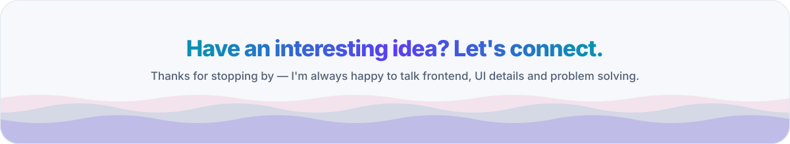

<picture>
  <source media="(prefers-color-scheme: dark)" srcset="assets/header-dark.svg">
  
</picture>

  <a href="https://www.linkedin.com/in/aathish-m/"><picture><source media="(prefers-color-scheme: dark)" srcset="assets/btn-linkedin-dark.svg"></picture></a>&nbsp;
  <a href="mailto:aathishm2002@gmail.com"><picture><source media="(prefers-color-scheme: dark)" srcset="assets/btn-email-dark.svg"></picture></a>&nbsp;
  <a href="https://github.com/aathish-m?tab=repositories"><picture><source media="(prefers-color-scheme: dark)" srcset="assets/btn-code-dark.svg"></picture></a>&nbsp;
  <a href="https://www.leetcode.com/aathish-m"><picture><source media="(prefers-color-scheme: dark)" srcset="assets/btn-leetcode-dark.svg"></picture></a>

## A little about me

I'm **Aathish**, a software engineer from **Palani, India**. I enjoy building for the web with React and TypeScript, exploring how things work, and turning what I learn into projects. My interests sit where **frontend engineering, user experience, and problem solving** meet.

<picture>
  <source media="(prefers-color-scheme: dark)" srcset="assets/about-dark.svg">
  
</picture>

## My toolkit

<picture>
  <source media="(prefers-color-scheme: dark)" srcset="assets/stack-dark.svg">
  
</picture>

## From my workbench

  <a href="https://github.com/aathish-m/Remind_Me"><picture><source media="(prefers-color-scheme: dark)" srcset="assets/project-remind-me-dark.svg"></picture></a>
  <a href="https://github.com/aathish-m/EventHub"><picture><source media="(prefers-color-scheme: dark)" srcset="assets/project-eventhub-dark.svg"></picture></a>

  <a href="https://github.com/aathish-m/Covid-Tracker"><picture><source media="(prefers-color-scheme: dark)" srcset="assets/project-covid-tracker-dark.svg"></picture></a>
  <a href="https://github.com/aathish-m/AlphaZ"><picture><source media="(prefers-color-scheme: dark)" srcset="assets/project-alphaz-dark.svg"></picture></a>

## In the open

<a href="https://github.com/aathish-m?tab=repositories">
<picture>
  <source media="(prefers-color-scheme: dark)" srcset="assets/stats-dark.svg">
  
</picture>
</a>

<picture>
  <source media="(prefers-color-scheme: dark)" srcset="https://raw.githubusercontent.com/aathish-m/aathish-m/output/github-snake-dark.svg">
  
</picture>

Refreshed daily with GitHub Actions. Public repositories only; original repositories exclude forks. Language counts use each original repository's primary language.

  

<picture>
  <source media="(prefers-color-scheme: dark)" srcset="assets/footer-dark.svg">
  
</picture>

  <a href="https://www.linkedin.com/in/aathish-m/">Find me on LinkedIn</a> · <a href="mailto:aathishm2002@gmail.com">Say hello by email</a>

