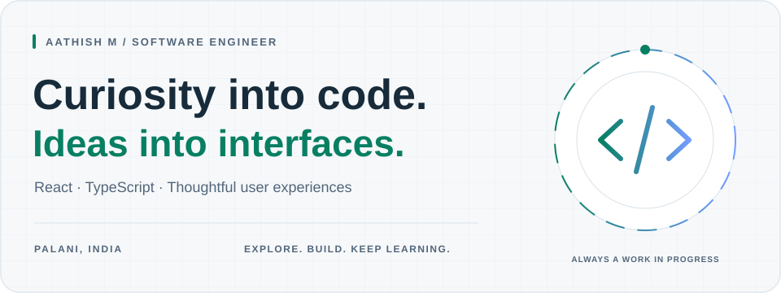
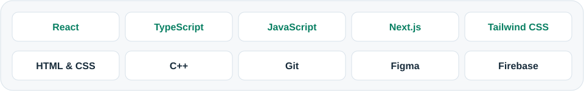
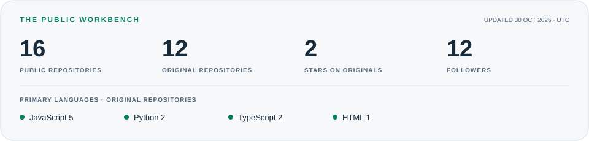

<picture>
  <source media="(prefers-color-scheme: dark)" srcset="assets/header-dark.svg">
  
</picture>

  <a href="https://www.linkedin.com/in/aathish-m/"><b>LinkedIn ↗</b></a> &nbsp; / &nbsp;
  <a href="mailto:aathishm2002@gmail.com"><b>Email ↗</b></a> &nbsp; / &nbsp;
  <a href="https://github.com/aathish-m?tab=repositories"><b>Explore my code ↗</b></a> &nbsp; / &nbsp;
  <a href="https://www.leetcode.com/aathish-m"><b>LeetCode ↗</b></a>

## A little about me

I'm **Aathish**, a software engineer from **Palani, India**. I enjoy building for the web with React and TypeScript, exploring how things work, and turning what I learn into projects.

My interests sit where **frontend engineering, user experience, and problem solving** meet. I'm an alumnus of **Coimbatore Institute of Technology**, and I've completed Google's **Foundations of User Experience (UX) Design** certification.

- **Building with** React, JavaScript, and TypeScript.
- **Exploring** useful interfaces, web applications, and new ideas through code.
- **Happy to talk about** frontend development, UI details, and problem solving in C++.

## My toolkit

<picture>
  <source media="(prefers-color-scheme: dark)" srcset="assets/stack-dark.svg">
  
</picture>

## From my workbench

<table>
<tr>
<td width="50%" valign="top">
<h3>01 &nbsp; Remind Me</h3>

A TypeScript web project built with Next.js, with Prisma, Clerk, and a component-based interface.

<code>TypeScript</code> <code>Next.js</code> <code>Prisma</code>

<a href="https://github.com/aathish-m/Remind_Me"><b>Explore the repository →</b></a>
</td>
<td width="50%" valign="top">
<h3>02 &nbsp; EventHub</h3>

A JavaScript project created for the Melinia hackathon. An experiment in building through collaboration.

<code>JavaScript</code> <code>Hackathon</code>

<a href="https://github.com/aathish-m/EventHub"><b>Explore the repository →</b></a>
</td>
</tr>
<tr>
<td width="50%" valign="top">
<h3>03 &nbsp; Covid Tracker</h3>

A web project exploring COVID-19 tracking and presenting information through a browser interface.

<code>HTML</code> <code>Web</code>

<a href="https://github.com/aathish-m/Covid-Tracker"><b>Explore the repository →</b></a>
</td>
<td width="50%" valign="top">
<h3>04 &nbsp; AlphaZ</h3>

A public discussion forum project. Exploring the web as a place for people and conversations.

<code>Community</code> <code>Discussion forum</code>

<a href="https://github.com/aathish-m/AlphaZ"><b>Explore the repository →</b></a>
</td>
</tr>
</table>

## In the open

<a href="https://github.com/aathish-m?tab=repositories">
<picture>
  <source media="(prefers-color-scheme: dark)" srcset="assets/stats-dark.svg">
  
</picture>
</a>

Refreshed daily with GitHub Actions. Public repositories only; original repositories exclude forks. Language counts use each original repository's primary language.

---

  <b>Have an interesting idea? Let's connect.</b> 
  <a href="https://www.linkedin.com/in/aathish-m/">Find me on LinkedIn</a> · <a href="mailto:aathishm2002@gmail.com">Say hello by email</a>

